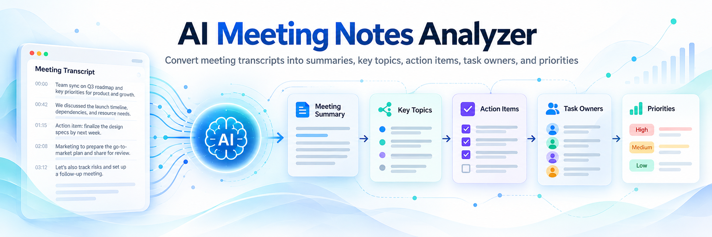
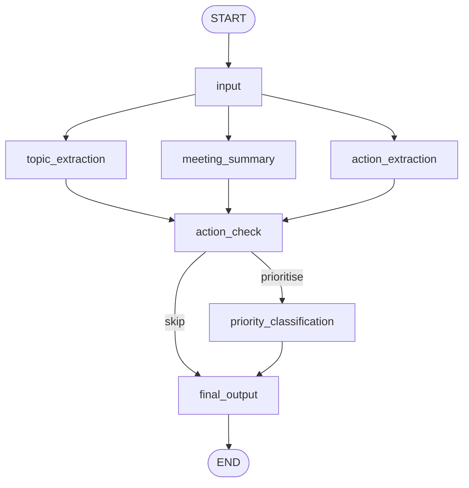

# AI Meeting Notes Analyzer using LangGraph

An AI-powered application that converts meeting transcripts into structured meeting notes using a LangGraph workflow. Three language-model agents run in parallel to extract key topics, generate a meeting summary and identify action items with their owners. A deterministic rule-based node then assigns task priorities, and a final node combines the results into a five-section meeting report.

The workflow is developed and validated in a Jupyter notebook and presented through an interactive Streamlit application.

---

## Project Objective

Companies conduct meetings every day, but key decisions, responsibilities and action items are not always captured systematically. This project automatically generates five structured outputs from an English meeting transcript:

1. **Meeting Summary** — a concise summary of 3–5 sentences.
2. **Key Topics** — the main subjects discussed.
3. **Action Items** — specific tasks and commitments.
4. **Task Owners** — responsible people or roles, with `Not specified` for unassigned tasks.
5. **Priority Level** — High Priority, Medium Priority or Low Priority for each task.

When no action items are identified, priority classification is skipped and the report displays:

`No action items identified in this meeting.`

---

## Project requirements vs Delivered

| Requirement | Implementation |
|---|---|
| Accept paragraphs, conversation transcripts and multiple speaker messages | Input node accepts all three forms; validated with T3, T2 and T1 |
| Topic Extraction Agent | LLM-based structured output containing distinct, transcript-grounded topics |
| Meeting Summary Agent | LLM-based summary limited to 3–5 sentences |
| Action Item Extraction Agent | LLM-based structured extraction of task, owner and deadline; unassigned tasks retain `Not specified` |
| Priority Classification | Deterministic LangGraph node assigning High, Medium or Low using task-specific urgency and timing signals |
| Conditional Logic | Routes to priority classification only when action items exist |
| Final Output | Generates all five required report sections in the specified order |
| Multiple AI Agents using LangGraph | Seven-node workflow with three parallel LLM agents and conditional routing |

---

## System Architecture



The workflow contains **7 nodes and 11 edges**.

### Execution flow

1. **Input Node:** Cleans and validates the transcript, rejecting empty input and transcripts exceeding 40,000 characters.
2. **Parallel AI Agents:** Topic Extraction, Meeting Summary and Action Item Extraction process the validated transcript.
3. **Action Check:** Waits for the parallel agents and determines whether action items exist.
4. **Conditional Routing:** Executes Priority Classification when actions are present; otherwise skips it.
5. **Final Output Node:** Combines the outputs into the five-section meeting report.

---

## LangGraph Nodes

| Node | Method | Responsibility |
|---|---|---|
| `input` | Deterministic Python | Normalizes and validates transcript input |
| `topic_extraction` | OpenAI `gpt-6-luna`, temperature 0, reasoning effort `none`, structured output | Identifies distinct key topics |
| `meeting_summary` | OpenAI `gpt-6-luna`, temperature 0, reasoning effort `none` | Produces a 3–5 sentence meeting summary |
| `action_extraction` | OpenAI `gpt-6-luna`, reasoning effort `medium`, structured output | Extracts tasks, owners and deadlines |
| `action_check` | Deterministic Python | Determines conditional routing |
| `priority_classification` | Deterministic Python | Assigns task priorities without an LLM call |
| `final_output` | Deterministic Python | Constructs the five-section report |

### Action item extraction

The Action Item Extraction Agent identifies:

- Explicit commitments and clear offers such as "I will", "Let me" and "I can".
- Tasks assigned to named people or roles.
- Specific directives such as "Please".
- Agreed next steps such as "Let's" and "We should".
- Explicitly required tasks that have not been assigned, such as "We need someone to".

The extraction rules exclude:

- Broad goals without specific task commitments.
- Questions without an agreed action.
- Speculation and observations.
- Deadline-only statements.
- Requests that only express urgency or prioritisation.

The agent preserves owner labels as stated in the transcript. Unassigned tasks are retained separately with owner `Not specified`, rather than being assigned to someone responsible for a related task.

Deadline information includes explicit timing and task-specific urgency signals. Exact duplicate action records are removed through deterministic normalization and comparison.

### Priority classification logic

Priority is assigned per task using case-insensitive, whole-word matching against the extracted task description and deadline information.

The classification follows these rules in order:

1. **Negated urgency handling:** The phrases `not urgent`, `not urgently` and `no rush` do not trigger High Priority on their own.
2. **High Priority:** Signals include `urgent`, `urgently`, `ASAP`, `immediately`, `right away`, `today`, `tonight`, `end of day`, `end of the day`, `tomorrow`, `within the hour`, `within the next hour`, `within an hour`, `this week`, and weekday references such as `by Friday`.
3. **Medium Priority:** Signals include `next` followed by a weekday, `next week`, `next month`, `soon`, `later`, `once`, `after`, `when` and `before`, provided no higher-priority signal takes precedence.
4. **Low Priority:** Applied when no High or Medium signal is detected.

For example:

- `urgent` → High Priority
- `ASAP` → High Priority
- `by tomorrow` → High Priority
- `this week` → High Priority
- `next week` → Medium Priority
- `not urgent` → Low Priority
- `not urgent, but by tomorrow` → High Priority

The priority node is **deterministic Python, not an LLM agent**. This ensures that the same extracted task and deadline inputs always receive the same classification.

Meeting-wide urgency is not automatically transferred to unrelated tasks.

---

## Example — Official project brief

### Input transcript

```text
John: We need to improve the website performance. Sarah: Yes, page load time is too slow. David: I will optimize the database queries this week. Sarah: I will redesign the homepage layout. John: Let's try to finish these tasks before Friday.
```

### Generated meeting report

```text
1. Meeting Summary
The meeting focused on improving website performance, particularly the slow page load time. David will optimize the database queries, and Sarah will redesign the homepage layout. The team aims to finish both tasks before Friday.

2. Key Topics
1. Website performance
2. Database query optimization
3. Homepage redesign

3. Action Items
1. Task: Optimize the database queries | Owner: David | Deadline: this week; before Friday | Priority: High Priority
2. Task: Redesign the homepage layout | Owner: Sarah | Deadline: before Friday | Priority: High Priority

4. Task Owners
Owner: David
- Optimize the database queries
Owner: Sarah
- Redesign the homepage layout

5. Priority Level
High Priority (2)
- Optimize the database queries
- Redesign the homepage layout
Medium Priority (0)
- None
Low Priority (0)
- None
```

---

## Test data

Seven controlled test cases were used during notebook development and validation.

| Case | Scenario | Purpose |
|---|---|---|
| T1 | Official website-performance example | Topic extraction, named owners, priorities and expected report |
| T2 | Community garden review | No-action detection and conditional skip |
| T3 | Charity-run planning paragraph | Paragraph input, named owners and unassigned tasks |
| T4 | Restaurant meeting | Role-based owners and High/Medium/Low priorities |
| T5 | Empty transcript | Input validation |
| T6 | Mobile app login-crash meeting, 47 speaker turns | Longer realistic transcript and 18-reference-action robustness benchmark |
| T7 | Office relocation follow-ups | Task-specific urgency, ownership separation, priorities and speculative-action exclusion |

The sample transcript is stored at:

`data/sample_transcript.txt`

---

## Notebook testing and results

The final notebook was executed using **Restart + Run All**, completing Steps 1–17 without execution errors.

| Validation | Verified result |
|---|---|
| T1–T7 controlled test table | 7/7 PASS |
| Official example T1 | Correct topics, named owners, both tasks High Priority |
| T7 action validation | All six expected tasks, owners and priorities correct |
| T6 robustness benchmark | All 18 reference actions represented among 22 extracted tasks |
| T6 timing, owner and priority checks | PASS |
| Priority validation for 18 benchmark tasks | 18/18 correct |
| Priority phrase checks, including negated urgency | 13/13 correct |
| Empty and whitespace-only input | Rejected |
| 40,000-character input | Accepted |
| 40,001-character input | Rejected |
| LangGraph architecture | 7 nodes and 11 edges verified |

Separate repeated runs during development confirmed that the ownership-sensitive cases T3 and T7 passed in 3 of 3 independent runs each.

The T6 robustness benchmark compares extracted actions against 18 reference actions. The final notebook run represented all 18 using 22 extracted task records, including separate records for related commitments.

Since LLM-generated outputs may vary across executions, the robustness benchmark does not impose a fixed total extracted-action count.

---

## Streamlit application

**Streamlit Cloud App link:** [Click here](https://ai-meeting-notes-analyzer.streamlit.app/)


The Streamlit application provides three tabs.

### Tab 1 — Analyze Meeting

Users can:

- Paste a meeting transcript.
- Upload a UTF-8 `.txt` transcript.
- Load the sample transcript.
- View the input character count against the 40,000-character limit.
- Run the LangGraph analysis.
- Follow workflow progress through status messages.

The Analyze meeting button is disabled for empty or whitespace-only input.

### Tab 2 — Meeting Report

Displays:

1. Meeting Summary
2. Key Topics
3. Action Items
4. Task Owners
5. Priority Level

Action items are displayed in a table containing:

| Task | Owner | Deadline | Priority |
|---|---|---|---|

Priority labels are colour-coded to distinguish High, Medium and Low.

Users can download:

- **`meeting_report.txt`** — the full five-section report.
- **`action_items.csv`** — action items with Task, Owner, Deadline and Priority columns, without an index column.

The CSV download is available only when action items exist.

### Tab 3 — Manager Task View

Provides:

- Filtering by individual task owner.
- An **All owners** view.
- An **Unassigned (Not specified)** option when applicable.
- High, Medium and Low task counts.
- A filtered task table ordered by priority.

The Manager Task View reuses the current analysis results and does not trigger additional model calls.

### Application scope

The **Scope & Limitations** panel describes the application's supported inputs, model-generated behavior, task-priority rules and session-based functionality.

---

## Streamlit regression testing

The application was tested through **13 regression scenarios**, all reported as passing.

| ID | Scenario | Result |
|---|---|---|
| ST1 | Application startup, banner, navigation and scope information | PASS |
| ST2 | Empty input handling | PASS |
| ST3 | Non-UTF-8 upload rejection | PASS |
| ST4 | Official example through pasted input | PASS |
| ST5 | TXT and CSV downloads | PASS |
| ST6 | Manager filtering for the official example | PASS |
| ST7 | No-action routing and replacement of previous results | PASS |
| ST8 | Office-move upload, ownership and urgency | PASS |
| ST9 | Manager filtering, including unassigned tasks | PASS |
| ST10 | Sample transcript robustness | PASS |
| ST11 | Customer portal launch integration | PASS |
| ST12 | Oversized input and stale-result clearing | PASS |
| ST13 | Missing API key handling | PASS — code review |

The customer portal launch integration scenario produced the expected 12 tasks:

- 5 High Priority
- 4 Medium Priority
- 3 Low Priority

The expected owner distribution was also verified: Engineering Lead (3), QA Lead (3), Marketing Manager (2), Customer Support Lead (2) and Not specified (2).

**ST13 was verified through code review rather than by deliberately removing API credentials or executing a missing-key scenario.**

The application regression results are distinct from the notebook's controlled agent-validation results.

---

## Validation and reproducibility

The development notebook validates individual workflow components before assembling and executing the complete graph.

Key validation practices include:

- Deterministic input, routing, priority and report logic tested separately.
- Structured LLM outputs validated against defined schemas.
- Controlled transcripts with expected action owners and priorities.
- Explicit validation of unassigned tasks.
- Independent repeated tests for ownership-sensitive cases.
- End-to-end LangGraph execution and Streamlit integration testing.
- Recorded PASS/FAIL results against predefined acceptance criteria.

The Topic Extraction and Meeting Summary agents use temperature 0. The Action Item Extraction agent uses reasoning effort `medium`, without an explicitly configured temperature.

Temperature 0 does not guarantee identical LLM outputs across runs. Therefore, model-dependent results may vary, while deterministic priority classification produces repeatable outputs for identical inputs.

`meeting_graph.py` contains the workflow definitions used by the Streamlit application and validated against the notebook implementation.

---

## Project structure

```text
AI_Meeting_Notes_Analyzer_using_LangGraph/
├── .streamlit/
│   └── config.toml
├── assets/
│   └── Meeting_notes_banner.png
├── data/
│   └── sample_transcript.txt
├── app.py
├── code.ipynb
├── meeting_graph.py
├── requirements.txt
└── README.md
```

Only application, notebook, configuration and supporting project files belong in the submitted repository.

The `.env` file containing the API key and local environment folders are not included in the repository.

---

## Prerequisites

- Python 3.12
- OpenAI API key
- Project dependencies from `requirements.txt`

---

## Technology stack

| Component | Version |
|---|---|
| Python | 3.12 |
| LangGraph | 1.2.12 |
| LangChain OpenAI | 1.6.7 |
| LangChain Core | 1.6.6 |
| OpenAI model | `gpt-6-luna` |
| Pydantic | 2.13.5 |
| Streamlit | 1.64.0 |
| pandas | 3.0.6 |
| python-dotenv | 1.2.4 |
| ipykernel | 7.4.0 |
| grandalf | 0.8 |

---

## Assumptions and scope

- Input is an English-language text meeting transcript.
- AI agents are instructed to produce outputs grounded in the transcript and avoid unsupported inferences.
- When an action has no clearly assigned owner, its owner is recorded as `Not specified`.
- Priorities depend on explicit urgency and timing language associated with each task.
- The application processes one meeting transcript per analysis.
- Audio and video transcription are not included in the current implementation.

---

## Known limitations

- The application supports English text transcripts; audio and video are outside the current scope.
- Transcript length is limited to 40,000 characters.
- LLM-generated topics, summaries and action items can vary between executions.
- Related commitments may occasionally be extracted as separate tasks.
- Priority classification relies on a defined list of urgency and timing phrases rather than broader managerial or business-impact judgment.
- Manager Task View displays tasks from the latest analysis in the current session; it does not store assignments, update progress or manage task completion.

Outputs should be reviewed by a person before being used for operational decisions.

---

## Future Enhancements

- **Longer transcript support:** Chunking to process transcripts beyond the current character limit.
- **Speech-to-text:** Accepting recorded meetings and converting audio into transcripts before analysis.
